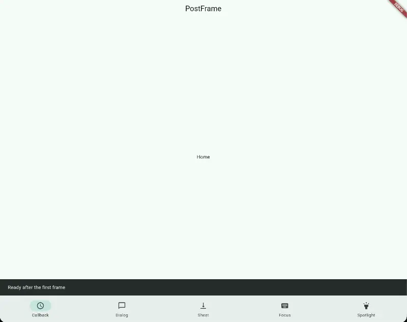

Show a popup, highlight a button for a tutorial, or run a callback after the child's first frame is drawn.
Your screen's `child` builds immediately.



Imports, app scaffolding, and supporting widgets are omitted below.

### Callback

```dart
PostFrameCallback(
  callback: showReadyMessage,
  child: const Text('Home'),
)
```

[Callback demo](example/lib/demos/callback_demo.dart) ·
[Feedback callbacks](example/lib/support/feedback.dart)

### Dialog

```dart
PostFrameDialog<String>(
  dialog: const CountryDialog(),
  onResult: showSelection,
  child: const Text('Country settings'),
)
```

[Dialog demo](example/lib/demos/dialog_demo.dart) ·
[Dialog content](example/lib/content/country_dialog.dart)

### Bottom sheet

```dart
PostFrameBottomSheet<String>(
  bottomSheet: const SortSheet(),
  onResult: showSelection,
  child: const Text('Items'),
)
```

[Sheet demo](example/lib/demos/bottom_sheet_demo.dart) ·
[Sheet content](example/lib/content/sort_sheet.dart)

### Spotlight

```dart
PostFrameSpotlight(
  clipper: const SpotlightOvalClipper(),
  maskInsets: const EdgeInsets.all(-8),
  child: const SpotlightTarget(),
)
```

The default shape is `SpotlightRRectClipper`. Positive insets shrink the hole;
negative values expand it for `OverflowBox` or other painted overflow. Bounds
come from the child's exact layout size, before those insets and ancestor
transforms are applied.

Use any `CustomClipper<Path>`, including Flutter's built-in shape clipper:

```dart
clipper: const ShapeBorderClipper(shape: StarBorder()),
```

The hole passes taps through; tapping the hole or shade dismisses the spotlight.
Set `dismissOnCutoutTap: false` to keep it open when the child is tapped.
`barrierDismissible` controls shade taps independently. Offscreen or
partially clipped targets raise `SpotlightTargetNotVisibleError` through the
shared `onError` policy. Automatic scrolling is not implemented.

[Spotlight demo](example/lib/demos/spotlight_demo.dart) ·
[Geometry and visibility](doc/spotlight.md) ·
[PostFrameScrollTo plan](doc/roadmap.md)

### Presentation options

Use `customShowDialog` or `customShowBottomSheet` to configure Flutter's native
presentation function. The presenter receives `context` and `builder`:

```dart
customShowDialog: ({required context, required builder}) => showDialog<String>(
  context: context,
  builder: builder,
  useRootNavigator: false,
  barrierDismissible: false,
),
```

[Custom presenters](example/lib/support/presenters.dart)

### Behavior

- Runs once per mount. Rebuilds do not repeat it; a new key starts a new lifecycle.
- `onResult(context, value)` receives the typed result, including null on dismissal,
  while the wrapper remains mounted.
- `callback` and `onResult` may be async. Return or await work whose errors should
  reach `onError(error, stackTrace)`. Without a handler, errors go to
  `FlutterError.reportError`.
- Removing a wrapper does not cancel started work or dismiss an open modal.
- Default presentation uses the root Navigator for dialogs and the nearest
  Navigator for sheets. Modal content needs its own route context to dismiss it.

Development checks live in [CONTRIBUTING.md](CONTRIBUTING.md).
